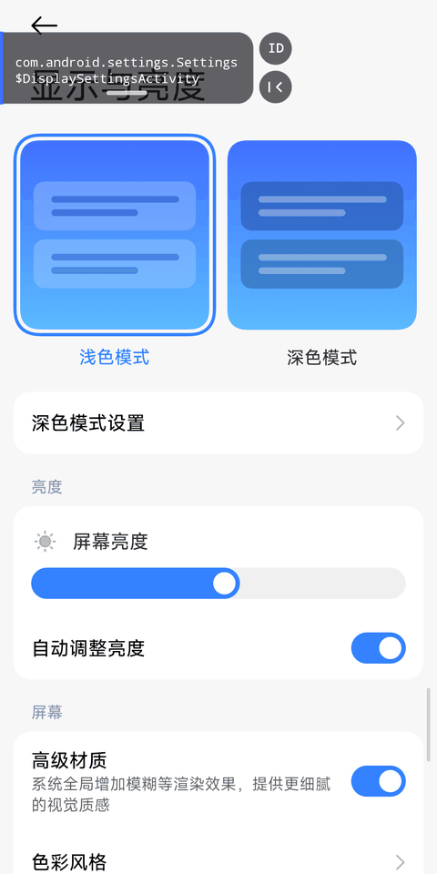
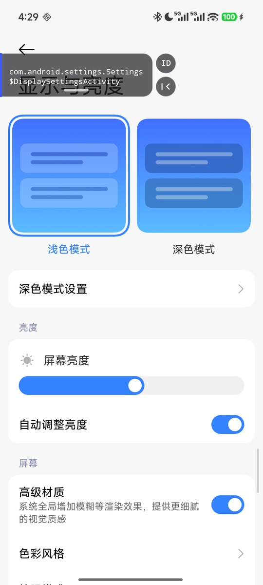
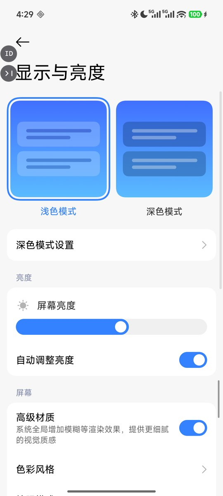
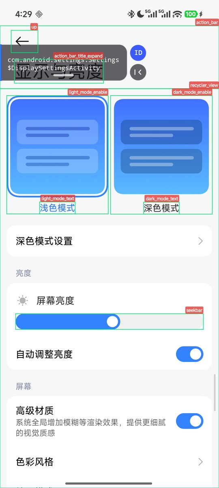
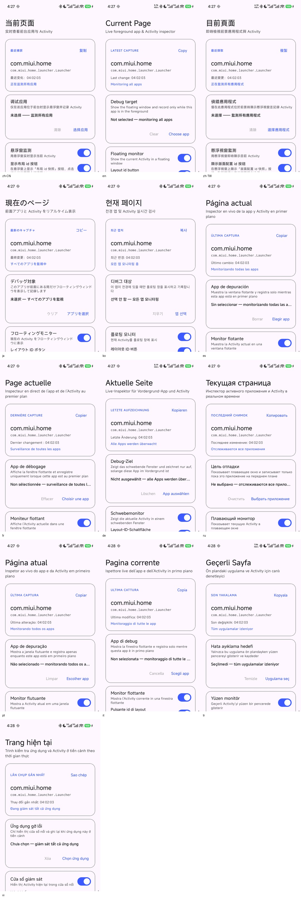

# Current Page

[English](README.en.md) · [简体中文](README.md) · [UI languages](docs/LANGUAGES.md)

> A lightweight Android foreground Activity inspector. It reads the current foreground package and Activity name through an AccessibilityService, shows them in a collapsible floating window, and can annotate layout ids on the target app.

[](LICENSE)
[](app/build.gradle.kts)

## Screens



| Overlay expanded | Overlay collapsed | Layout id labels |
| --- | --- | --- |
|  |  |  |

> Feature demos use the HyperOS system Settings app (Display & brightness) and contain no third-party app content.

### 13 UI languages



[View the full screenshot for each language](docs/LANGUAGES.md)

## Features

- **Live foreground Activity**: package name and Activity class, plus the concrete View subclass or layout ids when available.
- **Debug target filter**: show and record only while the chosen app is in the foreground; otherwise monitor all apps.
- **Collapsible overlay**: docked to the left edge, vertical drag, click-through card body, with a vertical `ID` / collapse button column.
- **Layout id snapshot**: tap `ID` to draw green boxes and translucent red id labels over every view with an `android:id`; labels avoid overlaps, tap again to clear.
- **Quick entry points**: Quick Settings tile and a long-press launcher shortcut.
- **Tri-state connection check**: distinguishes connected / enabled-but-not-connected / disabled, with recovery guidance for MIUI/HyperOS process reclamation.
- **History and copy**: keeps the last 12 changes and copies package + class name in one tap.
- **13 UI languages**: English, 简体中文, 繁體中文, 日本語, 한국어, Español, Français, Deutsch, Русский, Português, Italiano, Türkçe, Tiếng Việt.
- **Clean**: no internet permission, no draw-over-other-apps permission (`TYPE_ACCESSIBILITY_OVERLAY`), no persistent notification, no analytics.

## How it works

Android has no public API to read another app's foreground Activity. This app observes accessibility events:

```text
AccessibilityService
  └─ TYPE_WINDOW_STATE_CHANGED / TYPE_WINDOWS_CHANGED
       ├─ event.packageName / event.className  → overlay text
       ├─ event.windowId → getWindows().root   → traverse the view tree for View subclasses and layout ids
       └─ target filter / dialog guard / delayed hide
```

The overlay is added by the accessibility service with `TYPE_ACCESSIBILITY_OVERLAY`, so it needs no "display over other apps" permission.

**Known limits**

| Information | Supported | Notes |
| --- | --- | --- |
| Activity / Window class | ✅ | From window state events |
| Dialog / BottomSheet window class | ✅ | e.g. `androidx.appcompat.app.AlertDialog` |
| Concrete View subclass | ⚠️ | Only when the view exposes an accessibility class name; many custom Views are reported as framework base classes |
| Fragment / Composable function name | ❌ | Not part of the window/view tree; no public API |
| Layout ids | ✅ | Requires `flagReportViewIds`; only the target app's own ids are collected |

### Why are some layout ids missing?

1. **Namespace filter**: only ids in the target app's own package (`<pkg>:id/...`) are collected. AndroidX/Material ids and framework `android:id/...` are hidden on purpose to avoid noise.
2. **The accessibility tree is incomplete**: `GONE`, zero-sized, off-screen or `importantForAccessibility="no"` views are usually absent; Compose and WebView internals have no Android resource ids.
3. **Traversal cap**: one snapshot visits at most 800 nodes, so very large pages can be truncated.
4. **Label avoidance**: when all six candidate positions collide, the green box is still drawn but the id label is skipped to keep labels from overlapping.

## Usage

1. Install and open the app.
2. Enable the accessibility service when prompted (on Android 13+ sideloaded apps may need “App info → top-right menu → Allow restricted settings”).
3. Optional: choose a debug target; leave it empty to monitor all apps.
4. Open the target app — the overlay appears; switching away or going home hides it.
5. Overlay buttons: `ID` takes a layout id snapshot, `|‹` collapses the card back to the left edge.
6. Drag the card by the indicator line at the bottom; taps on the text area pass through to the app below.
7. Add the “Current Page” tile in Quick Settings to toggle monitoring.
8. On Android 13+, the UI language can be changed per app under “Settings → Apps → Current Page → Language”.

**UI languages**: English, 简体中文, 繁體中文, 日本語, 한국어, Español, Français, Deutsch, Русский, Português, Italiano, Türkçe, Tiếng Việt.

### Keep-alive (if accessibility drops)

**Not limited to MIUI/HyperOS.** If the overlay comes and goes, or the app reports “enabled but not connected”, the system is restricting this app in the background. Try:

- allow autostart;
- set the battery policy to “No restrictions”;
- after a system or APK update, toggle the accessibility switch off and on again.

Tested working on **HyperOS 3 (Xiaomi 15 Ultra)**.

## Build

Requirements:

- Android Studio with AGP 9.4 support and JDK 21
- Android SDK Platform 37 and Build-Tools
- Gradle is downloaded by the wrapper (9.6.0)

```bash
./gradlew :app:assembleDebug          # output: app/build/outputs/apk/debug/app-debug.apk
./gradlew :app:testDebugUnitTest      # JVM unit tests
./gradlew :app:lintDebug              # Android Lint
./gradlew :app:assembleRelease        # signed output: app/build/outputs/apk/release/app-release.apk
```

Release builds use APK Signature Scheme v2 + v3. Signing data lives only in the local `local.properties` (gitignored):

```properties
RELEASE_STORE_FILE=keystore/currentpage-release.jks
RELEASE_STORE_PASSWORD=***
RELEASE_KEY_ALIAS=currentpage
RELEASE_KEY_PASSWORD=***
```

`keystore/` and `local.properties` are never committed; CI automatically falls back to an unsigned release when these properties are absent.

If you do not have a keystore yet, generate one (keep the password out of shell
history and the repository):

```bash
keytool -genkeypair -v -keystore keystore/currentpage-release.jks \
  -storetype PKCS12 -alias currentpage -keyalg RSA -keysize 4096 -validity 10000
```


`settings.gradle.kts` prefers Aliyun Maven mirrors for users in mainland China, with the official repositories as fallback; adjust if you do not need them.

## Project layout

```text
app/src/main/java/com/oliver/app/currentpage/
├── data/          # Prefs, MonitorBus, MonitorState, ActivityRecord
├── domain/        # MonitoringController: single write path for monitoring state/target
├── service/       # MonitorAccessibilityService, Quick Settings tile
├── ui/            # MainActivity + MainViewModel, launcher shortcut
│   └── overlay/   # OverlayController, IdTagOverlay, IdTagLayout (unit-testable label placement)
└── util/          # AccessibilityUtils (tri-state connection check)
```

## Privacy

- No `INTERNET` permission; all processing stays on the device.
- Foreground package/class names and the last 12 records are kept in local SharedPreferences and can be cleared from “Recent changes”.
- Release builds disable sensitive debug logs (`BuildConfig.DEBUG`) and set `android:allowBackup="false"`, so usage records never enter cloud backups.
- Window content read by the accessibility service is used only for live display and manual id snapshots; nothing is uploaded or persisted beyond the package/class names and id names above.

## Distribution

Recommended distribution: **GitHub Releases / F-Droid / direct sideloading**. Using the Accessibility API for non-accessibility purposes may not satisfy Google Play policy; this project does not declare `isAccessibilityTool`.

## Tests and CI

- `app/src/test`: `ActivityRecord` text formatting and `IdTagLayout` label placement/avoidance.
- `.github/workflows/android.yml`: unit tests + Lint + Debug and Release assembly.

## Credits and license

Inspired by the approach of [willme/topactivity](https://github.com/willme/topactivity); the code here is a reimplementation.

Released under the [Apache License 2.0](LICENSE). Issues and pull requests are welcome.
