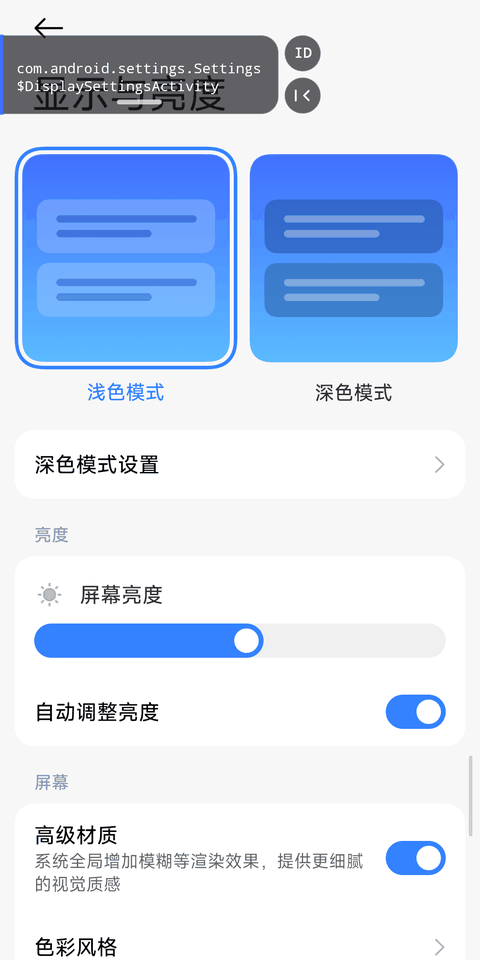
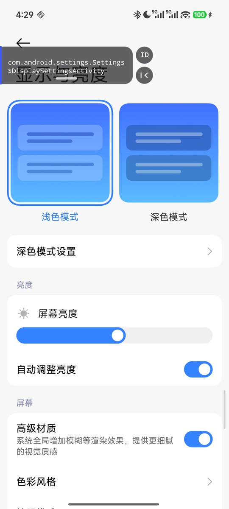
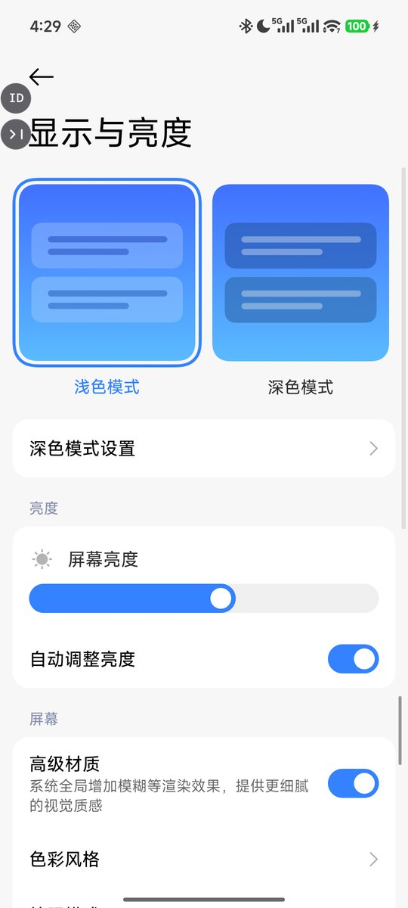
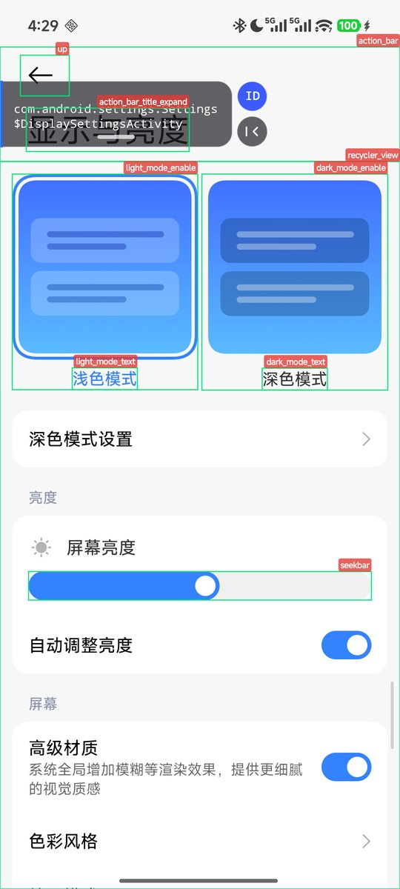
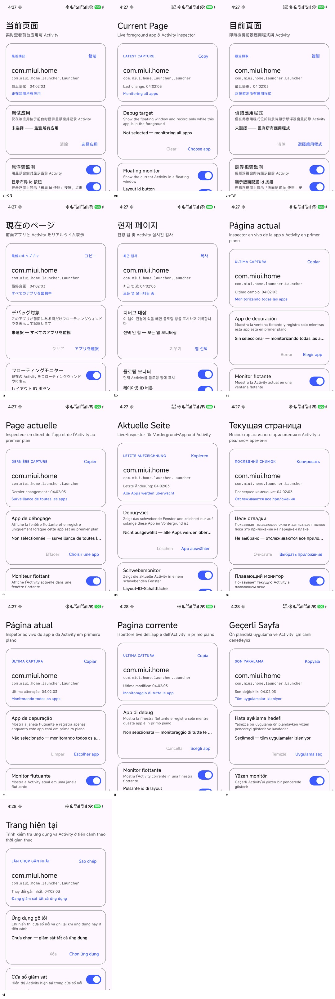

# Current Page · 当前页面

[简体中文](README.md) · [English](README.en.md) · [界面语言](docs/LANGUAGES.md)

> 一个轻量的 Android 前台 Activity 检查工具：用辅助功能服务实时读取当前前台应用的包名与 Activity 类名，通过可折叠悬浮窗展示，并支持在目标应用上标注布局 id。

[](LICENSE)
[](app/build.gradle.kts)

## 界面



| 悬浮窗展开 | 悬浮窗收起 | 布局 id 标注 |
| --- | --- | --- |
|  |  |  |

> 功能演示使用 HyperOS 系统「设置 → 显示与亮度」，不包含第三方应用内容。

### 13 种界面语言



[查看每种语言的完整截图](docs/LANGUAGES.md)

## 功能

- **实时前台 Activity**：显示包名、Activity 类名；能拿到具体 View 子类或布局 id 时一并展示。
- **调试应用过滤**：只关心的应用位于前台时显示与记录，切走自动隐藏；不选目标则监测所有应用。
- **可折叠悬浮窗**：贴左缘、纵向拖动、卡片主体点击穿透；右侧竖排「ID 快照」与折叠/展开按钮。
- **布局 id 标注**：在悬浮窗点 `ID`，给当前页面所有带 `android:id` 的视图画绿框和红色 id 标签，标签自动避让、不重叠；再点一次清除。
- **快捷入口**：快捷设置磁贴 + 桌面长按快捷方式，一键开关监测。
- **三态连接自检**：区分「已连接 / 已启用但未连接 / 未开启」，针对 MIUI/HyperOS 进程回收给出重连引导。
- **历史与复制**：保留最近 12 条变化，一键复制包名与类名。
- **13 种界面语言**：English、简体中文、繁體中文、日本語、한국어、Español、Français、Deutsch、Русский、Português、Italiano、Türkçe、Tiếng Việt。
- **干净**：无网络权限、无悬浮窗权限（`TYPE_ACCESSIBILITY_OVERLAY`）、无常驻通知、无统计 SDK。

## 工作原理

Android 没有公开 API 可以直接读取其他应用的前台 Activity。本项目监听辅助功能事件：

```text
AccessibilityService
  └─ TYPE_WINDOW_STATE_CHANGED / TYPE_WINDOWS_CHANGED
       ├─ event.packageName / event.className  → 悬浮窗文案
       ├─ event.windowId → getWindows().root   → 遍历视图树补全 View 子类与布局 id
       └─ 目标应用过滤 / 弹层窗口守卫 / 延迟隐藏
```

悬浮窗使用 `TYPE_ACCESSIBILITY_OVERLAY`，由辅助功能服务添加，因此不需要「显示在其他应用上层」权限。

**已知边界**

| 信息 | 支持情况 | 说明 |
| --- | --- | --- |
| Activity / Window 类名 | ✅ | 来自窗口状态事件 |
| Dialog / BottomSheet 窗口类 | ✅ | 例如 `androidx.appcompat.app.AlertDialog` |
| 内容 View 子类 | ⚠️ | 只有视图暴露了 accessibility class name 才拿得到；很多自定义 View 会被报告成框架基类 |
| Fragment / Composable 函数名 | ❌ | 不在窗口/视图树中，系统没有公开 API |
| 布局 id | ✅ | 需要 `flagReportViewIds`，只收集目标应用自己的 id |

### 为什么有些布局 id 不显示？

1. **命名空间过滤**：默认只收集目标应用自己包名的 id（`<pkg>:id/...`）。AndroidX、Material 等库的 id 和系统 `android:id/...` 不会显示，避免界面上出现大量框架 id。
2. **无障碍树本身不完整**：`GONE`、0 尺寸、屏幕外、`importantForAccessibility="no"` 的视图通常不在树里；Compose、WebView 内部也没有 Android 资源 id。
3. **遍历上限**：单次快照最多遍历 800 个节点，超大页面可能被截断。
4. **标签避让**：为了不重叠，6 个候选位置都冲突时只画绿框、不画 id 标签；框仍在，说明视图被识别到了。

## 使用

1. 安装并打开应用。
2. 按提示开启辅助功能服务（Android 13+ 侧载应用可能需要在「应用信息 → 右上角菜单 → 允许受限制的设置」放行）。
3. 可选：在「调试应用」里选择一个目标应用；不选则监测所有应用。
4. 打开目标应用，悬浮窗自动出现；切走或回桌面后自动隐藏。
5. 悬浮窗右侧竖排按钮：`ID` 拍一次布局 id 快照，`|‹` 折叠回左缘。
6. 按住卡片底部中间的指示线上下拖动；卡片文字区域的点击会穿透到下层应用。
7. 在快捷设置里添加「当前页面」磁贴，随时开关监测。
8. Android 13+ 可在「设置 → 应用 → 当前页面 → 语言」里单独切换界面语言。

**界面语言**：English、简体中文、繁體中文、日本語、한국어、Español、Français、Deutsch、Русский、Português、Italiano、Türkçe、Tiếng Việt。

### 保活设置（遇到辅助功能丢失时）

**不限于 MIUI / HyperOS。** 如果悬浮窗时有时无，或界面显示「已启用，但服务未连接」，说明系统在后台限制了本应用。可以尝试：

- 允许自启动；
- 把省电策略设为「无限制」；
- 更新系统或 APK 后，去辅助功能设置把开关关掉再打开一次。

本项目已在 **HyperOS 3（小米 15 Ultra）** 上实测可用。

## 构建

环境要求：

- Android Studio（支持 AGP 9.4）与 JDK 21
- Android SDK Platform 37、Build-Tools
- Gradle 由 wrapper 自动下载（9.6.0）

```bash
./gradlew :app:assembleDebug          # 产物 app/build/outputs/apk/debug/app-debug.apk
./gradlew :app:testDebugUnitTest      # JVM 单测
./gradlew :app:lintDebug              # Android Lint
./gradlew :app:assembleRelease        # 签名产物 app/build/outputs/apk/release/app-release.apk
```

Release 签名使用 APK Signature Scheme v2 + v3。签名信息只放在本机 `local.properties`（已 gitignore）：

```properties
RELEASE_STORE_FILE=keystore/currentpage-release.jks
RELEASE_STORE_PASSWORD=***
RELEASE_KEY_ALIAS=currentpage
RELEASE_KEY_PASSWORD=***
```

`keystore/` 与 `local.properties` 都不会进入仓库；CI 上没有这些属性时会自动退回未签名 Release。

本地配置了签名时，**debug 构建也会使用同一把 release key**，这样 debug 和 release APK 可以互相覆盖安装；未配置时 debug 仍使用默认 debug key。

如果没有现成 keystore，可以自己生成一个（密码不要写进命令历史/仓库）：

```bash
keytool -genkeypair -v -keystore keystore/currentpage-release.jks \
  -storetype PKCS12 -alias currentpage -keyalg RSA -keysize 4096 -validity 10000
```


国内网络环境下 `settings.gradle.kts` 优先使用阿里云 Maven 镜像，官方仓库作为兜底；如不需要可自行调整。

## 项目结构

```text
app/src/main/java/com/oliver/app/currentpage/
├── data/          # Prefs、MonitorBus、MonitorState、ActivityRecord
├── domain/        # MonitoringController：监测开关/目标的唯一写入口
├── service/       # MonitorAccessibilityService、快捷设置磁贴
├── ui/            # MainActivity + MainViewModel、桌面快捷方式
│   └── overlay/   # OverlayController、IdTagOverlay、IdTagLayout（可单测的标签避让）
└── util/          # AccessibilityUtils（三态连接检测）
```

## 隐私

- 没有声明 `INTERNET` 权限，所有数据只在设备本地处理。
- 前台包名/类名与最近 12 条记录保存在本机 SharedPreferences，可在「最近变化」里清空。
- Release 构建关闭了敏感调试日志（`BuildConfig.DEBUG` 控制），并设置 `android:allowBackup="false"`，使用记录不会进入云备份。
- 辅助功能读取的窗口内容只用于即时展示与手动 id 快照，不上传、不落盘（除上述包名/类名与 id 名称）。

## 分发说明

本项目推荐通过 **GitHub Releases / F-Droid / 直接侧载** 分发。无障碍 API 用于非辅助功能用途时，可能不符合 Google Play 的政策要求；本项目没有声明 `isAccessibilityTool`。

## 测试与 CI

- `app/src/test`：`ActivityRecord` 文本格式化、`IdTagLayout` 的标签放置与避让逻辑。
- `.github/workflows/android.yml`：单测 + Lint + Assemble Debug + Assemble Release。

## 来源与许可

本项目参考了 [willme/topactivity](https://github.com/willme/topactivity) 的实现思路，代码为重新实现。

以 [Apache License 2.0](LICENSE) 发布，欢迎 Issue / PR。
