# 界面语言 / UI languages

Current Page 目前支持以下 13 种界面语言。截图均为 App 自身界面，不含第三方应用内容。
Current Page currently ships with 13 UI languages. All screenshots are the app's own UI and contain no third-party content.

| **简体中文** | **English** | **繁體中文** |
| :---: | :---: | :---: |
| 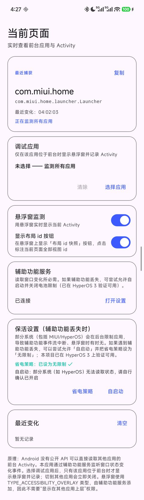 | 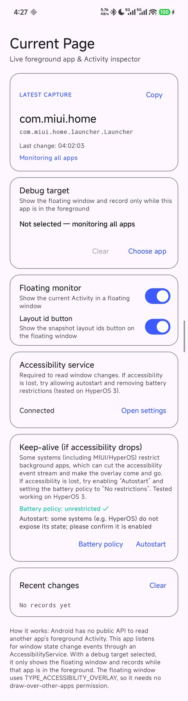 | 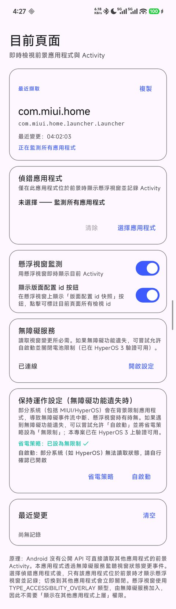 |
| **日本語** | **한국어** | **Español** |
| 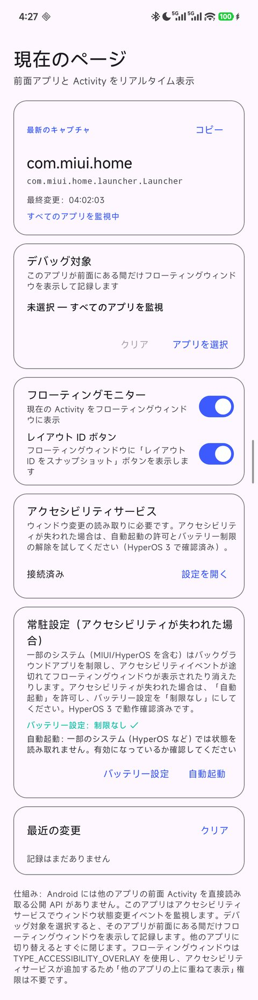 | 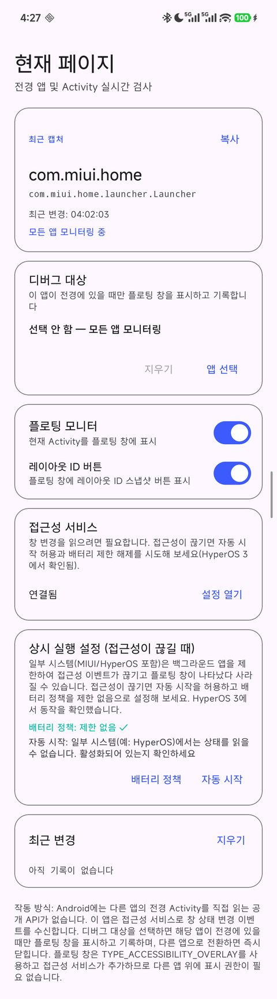 | 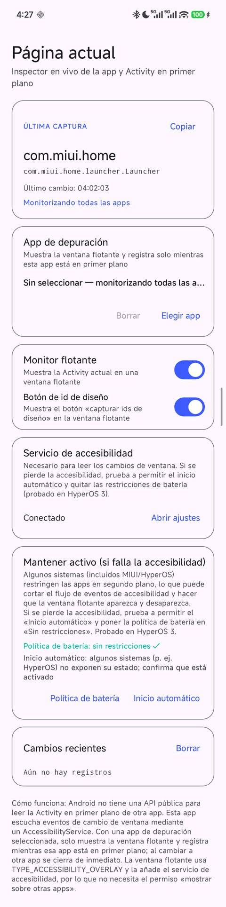 |
| **Français** | **Deutsch** | **Русский** |
| 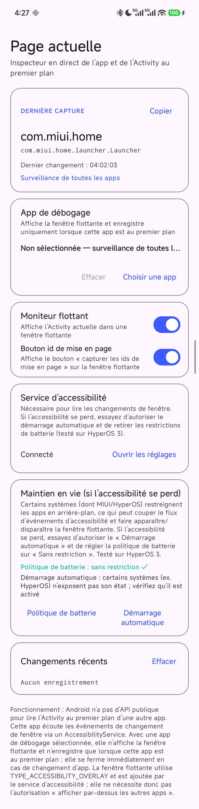 | 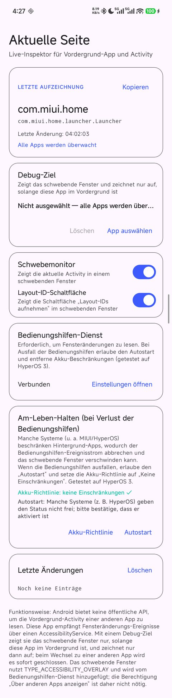 | 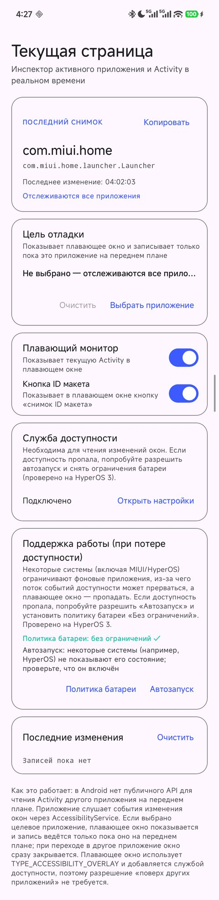 |
| **Português** | **Italiano** | **Türkçe** |
| 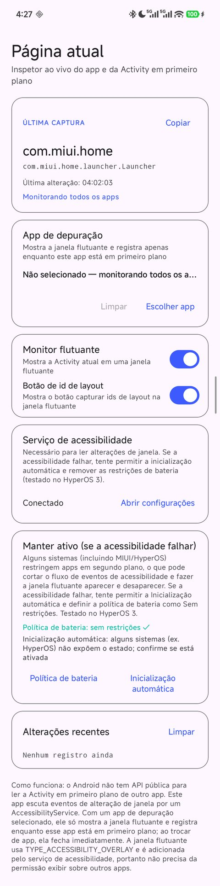 | 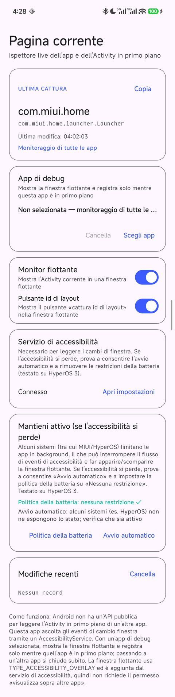 | 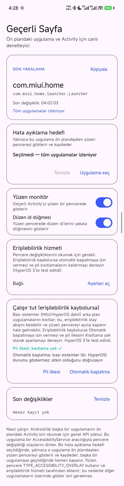 |
| **Tiếng Việt** | | |
| 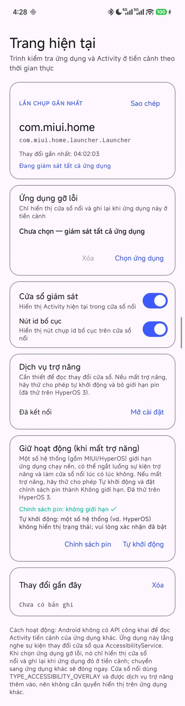 | | |
